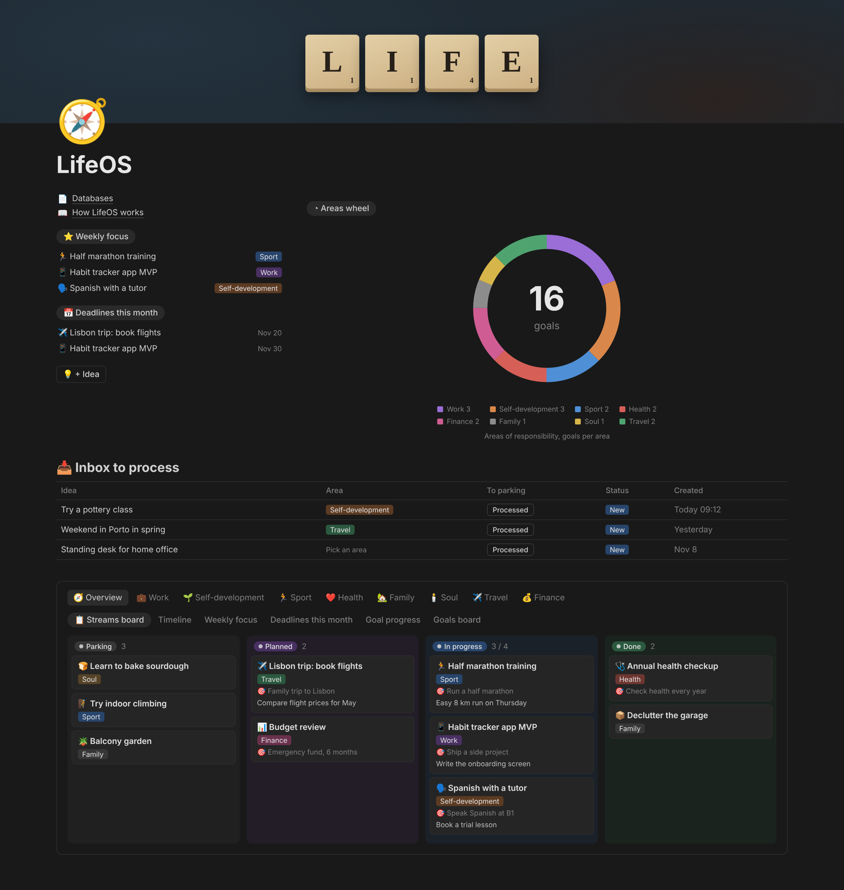

# LifeOS for Notion



AI made work faster, and it made switching harder. You start more things in a week than you used to in a month, then jump between them all day. Keeping all of that in your head doesn't work.

LifeOS keeps your goals, what you're working on and the next step for each in one Notion dashboard. When you switch, it shows where you stopped. Claude reads the same dashboard, so a new chat picks up the context too.

Claude sets it up in about 5 minutes, then you run it by talking to Claude. I built it for myself. This is the same setup, without my data.

## What's inside

- Goals and streams. A goal is the outcome, a stream is the work toward it.
- Areas. Work, Sport, Travel and so on, each with its own board.
- Inbox. Press + Idea to save an idea, pick its area, press Processed to park it there.
- Weekly focus and a WIP limit. Up to 3 streams in focus, 4 in progress by default.

Treat it as a starting point. Use it for a couple of weeks, then ask Claude to change what doesn't fit.

## Install

You need Notion and Claude. Pick one way.

### Claude app (web, desktop, mobile)

1. Connect Notion: Settings, Connectors, Notion. Add the official Notion plugin too if your app offers it. More in [mcp/README.md](mcp/README.md).
2. Duplicate the [LifeOS template](https://vivid-nerine-985.notion.site/LifeOS-414bfea07f4381b7b48aeebffe53cb40) into your Notion.
3. New chat, send this:

   > Set up LifeOS using https://github.com/vlaskos/lifeos/blob/main/skills/lifeos-setup/SKILL.md

Claude asks a few short questions with quick options, starting with the dashboard language. Nothing changes in Notion until you confirm the plan.

### Skills in your Notion

At the end of setup Claude can save the daily skills as pages in your Notion. Then any chat with the Notion connector can use them, no uploads.

Add this to your Claude instructions so it looks there:

> I keep my skills in Notion. When a skill might apply, list my Notion skills and use the matching one.

### Claude Code

Official Notion plugin first, then LifeOS:

```text
/plugin marketplace add makenotion/claude-code-notion-plugin
/plugin install notion-workspace-plugin@notion-plugin-marketplace
/plugin marketplace add vlaskos/lifeos
/plugin install lifeos@lifeos
```

Restart Claude Code, approve Notion access in the browser, say "set up LifeOS".

### Any agent (Codex, Cursor, Copilot)

LifeOS also ships as an [Agent Plugins 1.0](https://agent-plugins.org) package: a root `plugin.json`, an `mcp.json` pointing at the hosted Notion MCP, and the same `skills/`. Any conformant client loads the folder. The format is standard; the install command isn't, so it's per client.

```text
git clone https://github.com/vlaskos/lifeos
```

Codex: copy `skills/lifeos-*` into `~/.agents/skills/`, add the `notion` server from `mcp.json` to `~/.codex/config.toml`, then run `codex mcp login notion`. Other clients: point their plugin loader at the folder.

Duplicate the template, say "set up LifeOS". The skills are plain language, so they carry over; only the Notion tool names may differ.

### ZIP

Skill ZIPs are in [Releases](https://github.com/vlaskos/lifeos/releases). In Claude: Customize, Skills, +, Upload a skill.

## How to use it

| Say | Skill |
|---|---|
| "set up LifeOS", "add an area Hobby" | `lifeos-setup` |
| "save an idea: buy a tent" | `lifeos-capture` |
| "process my inbox" | `lifeos-inbox` |
| "plan my week" | `lifeos-focus` |
| "what's my status?" | `lifeos-status` |
| "close the stream LinkedIn" | `lifeos-update` |

## Notion plugin

LifeOS has no Notion server of its own. It uses the official Notion connector or [Notion plugin](https://github.com/makenotion/claude-code-notion-plugin). Their skills handle the rest of your Notion, LifeOS skills only manage the dashboard.

## Repo

```
spec/lifeos.yaml   databases, views, dashboard, limits
skills/            lifeos-setup + 5 daily skills
.claude-plugin/    Claude Code plugin and marketplace
mcp/README.md      how to connect Notion
```

## Limits

- Notion Free allows one chart per workspace. The Areas wheel is a chart, so if you already use one, you'll see "Upgrade" instead.
- Notion buttons can't check conditions. Pick an Area before you press Processed.
- The Notion API can't create buttons or delete views. That's why you start from the template.

## License

MIT, Vlad Kosyi
